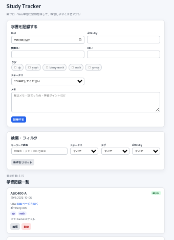

# Study Tracker

競技プログラミングの学習内容を記録し、復習状況を管理するWebアプリです。

問題ごとにDifficulty・タグ・ステータス・メモなどを保存し、検索・フィルタを使って学習内容を振り返ることができます。

## デモ

[Study Tracker を試す](https://study-tracker-app-umber.vercel.app/)

## アプリ画面



## 主な機能

- 学習記録の登録・編集・削除
- MongoDBへのデータ保存
- キーワード検索
- ステータス・タグ・Difficultyによるフィルタ
- React Hook Formによる入力バリデーション
- バックエンド側での入力バリデーション
- Loading・エラー表示
- レスポンシブ対応

## 使用技術

### Frontend

- React
- JavaScript
- Vite
- React Hook Form
- CSS

### Backend

- Node.js
- Express
- MongoDB
- Mongoose
- Zod

### Infrastructure

- Vercel
- Render
- MongoDB Atlas

## 工夫した点

- React Hook Formによるフロントエンド側の入力チェックに加え、
  Zodを使用してバックエンド側でも入力値を検証
- Expressのroutes / controllerを分離し、処理の責務を整理
- 複数条件をAND条件で組み合わせられる検索・フィルタ機能を実装
- API通信中のLoading表示や通信エラー時の再読み込み機能を実装
- 編集時にフォームまで自動スクロールするなど、操作性を改善
- PC・スマートフォンの両方で利用できるレスポンシブUIを実装

## ローカルでの起動

### Frontend

```bash
cd frontend
npm install
npm run dev
```

### Backend

```bash
cd backend
npm install
npm run dev
```

`.env` にMongoDBの接続情報やAPI URLなどの環境変数を設定する必要があります。
`.env.example` を参考に環境変数を設定してください。

## 今後の改善予定

- 検索・フィルタ処理のバックエンド化
- ユーザー登録・ログイン機能
- ユーザーごとの学習記録管理
- 学習データの分析・可視化
- TypeScript対応
- テストの追加
